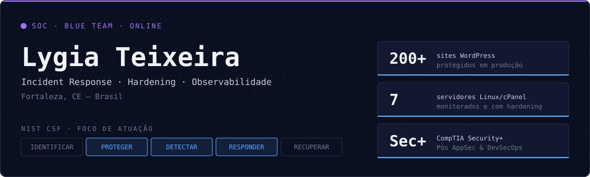

Construo minha trajetória em cibersegurança, com foco em Blue Team, AppSec e DevSecOps. Atuo na proteção de ambientes de produção com mais de 200 sites WordPress em servidores Linux/cPanel, aplicando hardening, monitoramento e resposta a incidentes. Com a certificação CompTIA Security+, busco aprofundar essa experiência em segurança de aplicações e automação de controles, integrando proteção ao desenvolvimento e à operação de sistemas.

## Playbook

| | |
|:--|:--|
| 🟢 **DETECTAR** | Stack de observabilidade (Grafana · Prometheus · Loki · Alloy) com alertas de CPU, memória, disco e servidor offline |
| 🔴 **RESPONDER** | Remoção de webshells e backdoors, análise de logs HTTP, contenção e pós-incidente documentado |
| 🔵 **PROTEGER** | Baselines de servidor e de cabeçalhos HTTP, firewall (CSF/lfd), WAF e TLS |
| 🟡 **AUTOMATIZAR** | Python, Node.js, Bash e n8n para tirar tarefas de segurança do modo manual |

## Stack

<table>
<tr><td>INFRA & CLOUD </td>
<td>OBSERVABILIDADE </td>
<td>CÓDIGO </td></tr>
</table>

**Segurança** — Wazuh · Wireshark · Nmap · Trivy · CSF/lfd · Vaultwarden  
**Também** — cPanel/WHM · Loki · n8n · Jira · Playwright  
**Frameworks** — MITRE ATT&CK · NIST CSF · ISO/IEC 27001 · LGPD

## Projetos

<table>
<tr>
<td width="33%" valign="top">

**[lacrei-devops-challenge](https://github.com/Lygia-Teixeira/lacrei-devops-challenge)**

Pipeline de deploy seguro na AWS: OIDC sem chaves fixas, scan Trivy bloqueante, aprovação manual para produção, rollback e alarmes

</td>
<td width="33%" valign="top">

**[linux-observability-stack](https://github.com/Lygia-Teixeira/linux-observability-stack)**

Monitoramento de frota Linux/cPanel: métricas, logs categorizados (firewall, auth, WAF, web) e alertas calibrados

</td>
<td width="33%" valign="top">

**[incident-response-writeups](https://github.com/Lygia-Teixeira/incident-response-writeups)**

Incidentes reais anonimizados: linha do tempo, causa raiz, MITRE ATT&CK e playbooks de contenção

</td>
</tr>
<tr>
<td width="33%" valign="top">

**[linux-web-hardening-baseline](https://github.com/Lygia-Teixeira/linux-web-hardening-baseline)**

Baseline de hardening de servidor, sites WordPress e e-mail (SPF/DKIM/DMARC), com scripts de verificação read-only

</td>
<td width="33%" valign="top">

**[oidc-sso-bridge](https://github.com/Lygia-Teixeira/oidc-sso-bridge)**

Provedor OIDC que leva contas de uma aplicação legada ao Vaultwarden: PKCE, 2FA e tiquete de uso único anti-replay

</td>
<td width="33%" valign="top">

**[credential-rotation-engine](https://github.com/Lygia-Teixeira/credential-rotation-engine)**

Compliance de idade e rotação de credenciais com dry-run, confirmação por hash do plano e rollback

</td>
</tr>
<tr>
<td width="33%" valign="top">

**[wp-fleet-inventory](https://github.com/Lygia-Teixeira/wp-fleet-inventory)**

Inventário agentless de sites WordPress via SSH, com host key verificada e credenciais cifradas (AES-256-GCM)

</td>
<td width="33%" valign="top">

**[security-scripts](https://github.com/Lygia-Teixeira/security-scripts)**

Scanner de malware PHP, analisador de logs HTTP (SQLi, XSS, LFI, força bruta, scanners) e checklist de hardening WordPress

</td>
<td width="33%" valign="top">

**[popup-go](https://github.com/Lygia-Teixeira/popup-go)**

Plugin WordPress de pop-ups com carrossel, segmentação por página e entrada sanitizada (nonce, capability, whitelist)

</td>
</tr>
<tr>
<td width="33%" valign="top">

**[wp-anti-injection](https://github.com/Lygia-Teixeira/wp-anti-injection)**

Scanner de injeções no banco do WordPress: detecção read-only, limpeza ciente de serialização, quarentena com restauração e WP-CLI

</td>
<td width="33%" valign="top">

**[agenda-eventos-wp](https://github.com/Lygia-Teixeira/agenda-eventos-wp)**

Plugin WordPress de agenda com painel lateral, filtros, destaques e personalização, com nonce, capabilities próprias e saída escapada

</td>
<td width="33%" valign="top">

**[pdf-batch-uploader](https://github.com/Lygia-Teixeira/pdf-batch-uploader)**

Envio em lote de PDFs para portais multi-tenant: dry-run, validação de tenant, deduplicação por SHA-256 e logs sem dados pessoais (LGPD)

</td>
</tr>
<tr>
<td width="33%" valign="top">

**[jira-n8n-ops-automation](https://github.com/Lygia-Teixeira/jira-n8n-ops-automation)**

Cards do Jira resolvidos por n8n: desbloqueio de IP, cota e senha de e-mail via catálogo fixo de comandos, renovação de SSL e notícias, com dry-run e auditoria

</td>
<td width="33%" valign="top">

</td>
<td width="33%" valign="top">

</td>
</tr>
</table>

## Casos reais (anonimizados)

> [!NOTE]
> Resumos de incidentes em que atuei em ambiente de produção. Os nomes de clientes e de servidores foram omitidos. Versões completas em [incident-response-writeups](https://github.com/Lygia-Teixeira/incident-response-writeups).

<code>INC-01</code> <b>Falso CAPTCHA "ClickFix" injetado via plugin de pop-up</b>

 

| | |
|:--|:--|
| **Cenário** | Vários sites passaram a exibir uma página falsa de verificação da Cloudflare que induzia o visitante a executar um comando no próprio computador. A injeção vinha da configuração de um plugin de pop-ups. |
| **Resposta** | Identifiquei o vetor e os indicadores nos logs de acesso, limpei as configurações afetadas e mapeei os outros sites com o mesmo padrão. |

<code>INC-02</code> <b>Webshells que sobreviveram à reinstalação do WordPress</b>

 

| | |
|:--|:--|
| **Cenário** | O site foi reinstalado e voltou a ser comprometido, porque os arquivos maliciosos estavam fora da árvore do WordPress, na home da conta. |
| **Resposta** | Varredura completa da home, quarentena de cerca de 40 artefatos com a cadeia de evidência preservada e recomendação de rotação de credenciais. |

<code>INC-03</code> <b>Firewall bloqueando a própria ferramenta de gestão</b>

 

| | |
|:--|:--|
| **Cenário** | Sites "caíram" em massa no painel de gerenciamento. A causa raiz era o lfd/CSF banindo o IP da ferramenta por um falso positivo de regra do mod_security. |
| **Resposta** | Correlação entre os logs do firewall e os do WAF, liberação permanente e controlada do IP e replicação do ajuste nos demais servidores. |

<code>INC-04</code> <b>Degradação de servidor por saturação do Apache</b>

 

| | |
|:--|:--|
| **Cenário** | Lentidão generalizada causada por tráfego anômalo vindo de um único NAT, com o MPM prefork saturado. |
| **Resposta** | Diagnóstico pelos logs, migração para o `mpm_event` e remoção de cópias de diretórios expostas publicamente. |

## Formação & certificações

<table>
<tr>
<td valign="top" width="50%">

**Formação**

- Pós-graduação em AppSec e DevSecOps — *em andamento*
- Defesa Cibernética

</td>
<td valign="top" width="50%">

**Certificações**

- `2026` CompTIA Security+
- `2025` Analista de Infra e Redes — CECyber
- `2025` Santander Bootcamp Cibersegurança #2
- `2024` Google Cybersecurity Professional Certificate
- `2024` Hackers do Bem — Governo Federal
- `2023` ISO/IEC 27001 Associate

</td>
</tr>
</table>

Segurança na prática, não só no papel.

